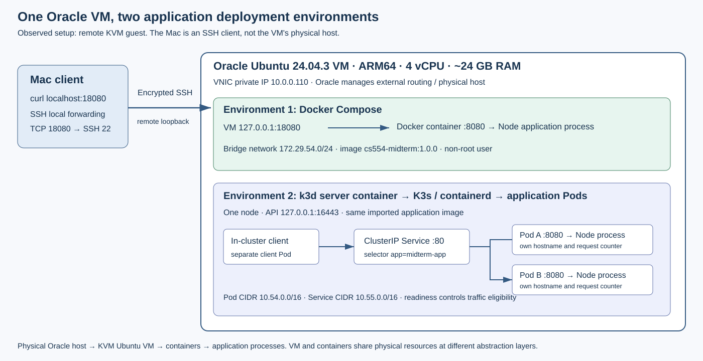

# CS554 Midterm Report

Jiapeng Chen · Fall 2026

## 1. Setup

I used the Node.js starter from class. The main change to the application was a small readiness check for the CS554 experiment. The `/` endpoint returns the service name, message, hostname, and request count. The count is stored in memory and belongs to one process. Requests to `/health` do not increase it.

I ran both parts on one Oracle Ubuntu 24.04.3 VM. It has four ARM64 CPUs and about 24 GB of RAM. Compose runs one application container, while k3d runs a single-node Kubernetes cluster on the same VM. The cluster has two application Pods. I built `cs554-midterm:1.0.0` with Compose and imported that image into k3d, so both parts use the same application image.

Oracle provides the physical machine and the KVM virtual machine. Docker containers use the Ubuntu VM's kernel, and Node runs as a process inside each application container. The k3d node is also a container. My Mac connects to this remote VM over SSH.

The VM uses Oracle's virtual networking, with private VNIC address `10.0.0.110`. My Mac is an external SSH client. To access the Compose service from my Mac, I forwarded local port 18080 through SSH to the VM's loopback port 18080. Docker's bridge network maps that port to port 8080 inside the container. Both `/` and `/health` returned HTTP 200 from the Mac. The commands and responses are in [E1b](../evidence/01-host-access.txt).

## 2. Compose and Kubernetes

With Compose, I checked the service status, logs, and both endpoints. Two requests to `/` returned counts 1 and 2. After restarting the service, the next request returned 1. The hostname stayed the same, but the process restarted and its counter was reset. There was a short connection reset while the application was starting again, followed by a successful response ([E1](../evidence/01-compose.txt)).

In Kubernetes, both application Pods became Ready. The Service listens on port 80 and forwards to port 8080 in the Pods. I used a separate client Pod to send requests through the Service. The responses showed different Pod hostnames and separate request counts. I did not assume the requests would alternate in a fixed order ([E2](../evidence/02-cluster.txt)).

I then deleted `midterm-app-5bc4dcd798-6vltq`. A new Pod, `midterm-app-5bc4dcd798-fnsgw`, appeared, and the Deployment returned to two Ready replicas. Kubernetes created it because the Deployment still requested two replicas. The other Pod kept running. This was different from the Compose restart: Compose restarted the process in the existing container, while Kubernetes replaced the deleted Pod ([E3](../evidence/03-pod-replacement.txt)). Since there was only one node, this test did not cover losing the whole VM.

## 3. Service troubleshooting

I changed the Service selector from `app: midterm-app` to `app: midterm-app-mismatch`. Both application Pods were still Ready, but a request through the Service failed. The Pod labels had not changed, so the new selector matched no Pods. EndpointSlices showed zero ready backends ([E4](../evidence/04-selector-failure.txt)).

I checked the Pod labels, the Service selector, and the EndpointSlices to find the problem. After changing the selector back, there were two ready endpoints again and the request returned HTTP 200. This showed why checking only Pod status was not enough: the application could be healthy while the Service configuration was wrong. I used the Service address for this test because requesting a Pod directly would skip the selector.

## 4. OpenStack deployment plan

For OpenStack, I would start by listing the available images, flavors, and networks. The class example uses `ubuntu-24.04`, `m1.small`, `private`, `private-subnet`, `router1`, and the external network `public` [1]. I would check which of these already exist in the assigned project. Their names are useful, but I would look up the current IDs rather than copy IDs from an older example. I would also check the CPU architecture, since the image built on my Oracle VM is ARM64. If the OpenStack VM were AMD64, I would rebuild the application image for that architecture.

For this small service, I would start with about one or two vCPUs and 2 GB of RAM, after checking what the available flavors provide. My Oracle VM has 24 GB, but this application does not need that much memory. I would register an SSH public key, create a security group, and connect the VM to the private subnet. The cloud administrator may already supply the Ubuntu image, flavors, external network, private network, subnet, and router. If the project allows it and these are missing, I would create the tenant network and subnet, then connect the router to the external network. Finally, I would allocate a floating IP and attach it to the VM's network port [1, 2].

The OpenStack services have different jobs. Keystone checks my identity and permissions. Glance provides the Ubuntu image. Nova creates the VM using the chosen image and flavor. Neutron sets up its networking, including its port, fixed IP, router access, security groups, and floating IP [3]. Once the VM is ready, I would check that cloud-init has finished, install Docker and Compose, copy the project files, build the image, and start the service. Compose would run inside the VM, just as it did in my experiment.

I would not add a separate Cinder volume for this workload. The request count is supposed to reset with the process, and there is no database or uploaded data to keep. The VM still needs a boot disk. Depending on the cloud's setup, that could be image-backed or volume-backed, but an extra data volume would not help this application.

For direct access from an external client, I would publish VM port 18080 to container port 8080. I would change the loopback-only binding used in my SSH experiment so the VM can accept that connection. The request would go to the floating IP, pass through the cloud's routing and IP mapping, pass the security-group and guest-firewall checks, and reach the container through the published port. The security group would need a TCP 18080 ingress rule. TCP 22 allows SSH, and ICMP allows ping; neither one allows the application's HTTP traffic on its own [2].

If the VM were ACTIVE but the service could not be reached, I would work outward from the application. First, I would check the container logs and `/health`. Then I would check Compose status, listening ports, port mappings, the Ubuntu firewall, and cloud-init. I would save `docker compose logs`, `docker compose ps`, VM-local curl responses, and firewall output to separate application and VM problems. If VM-local access worked, I would check the fixed IP, security group, router, and floating-IP association. At that layer, I would collect the security-group rules, network-port details, and floating-IP association from the OpenStack CLI. An ACTIVE VM does not necessarily mean that its application has finished starting [1].

Running the OpenStack cloud itself is more work because its compute, storage, networking, identity, and other services must work together [3]. In the October 12 lecture, the instructor described DevStack storage activity triggering a failing NVMe drive and freezing the host. He moved the virtual disks to another SSD [4]. That was an infrastructure problem, rather than a bug in the small web service. For one simple application, a VM with Compose may be enough. Kubernetes added automatic Pod replacement and readiness-based Service routing in my tests, but also needed more setup.

## 5. CS554: resources and readiness

I set each application container's requests to 100 millicores and 64 MiB, and its limits to 500 millicores and 128 MiB. Requests help Kubernetes decide where a Pod can run. They do not mean the application always uses that amount. The CPU limit can throttle the container, while going over the memory limit can lead to an out-of-memory termination. The application used about 11 MiB under Compose, so these settings leave some extra room. The CPU settings give this mostly idle demo a small request and room for short bursts. I did not run a load test, so I would check them again for a larger workload.

The readiness probe checks `/health` every two seconds. To make only one replica fail, I created `/tmp/midterm-not-ready` inside that Pod. Its health endpoint returned 503, but the application kept running. Kubernetes showed the Pod as Running with `0/1` Ready. Its EndpointSlice entry had `ready: false`, leaving the other Pod as the only ready Service backend [5, 6].

I checked that the Pod UID, container ID, and restart count stayed the same. PID 1 was still Node, and a direct request to that Pod's `/` endpoint returned 200. All eight sampled requests through the Service reached the other Pod. After I removed the file, `/health` returned 200 again and there were two ready endpoints. This helped me see the difference between readiness and restarting: readiness changed which Pod could receive Service traffic without restarting its process. The logs are in [E5](../evidence/05-readiness.txt), with the [recovery Pods](../evidence/05-readiness-recovery-pods.json) and [EndpointSlices](../evidence/05-readiness-recovery-endpointslices.json) supporting E6.

## References

The experiment files are listed in the [evidence index](../evidence/index.md). The Pod names and counts above refer to those original logs. A later run is also shown in [terminal screenshots](../evidence/screenshots/README.md), where names and counts may differ. The OpenStack section is a written plan; I did not install OpenStack for this project.

1. [Class Exercise 05 and OpenStack settings](https://github.com/UAH-Computer-Science/cs454-Course-Exercises/tree/8c572c153086cc68773c0e5804ccc0104ca34b3e/exercise-05-openstack-iaas).
2. OpenStack, [Configure access and security for instances](https://docs.openstack.org/horizon/latest/user/configure-access-and-security-for-instances.html).
3. OpenStack, [Installation Guide](https://docs.openstack.org/install-guide/).
4. CS454/554 lecture, October 12, 2026, opening DevStack discussion.
5. Kubernetes, [Liveness, Readiness, and Startup Probes](https://kubernetes.io/docs/concepts/workloads/pods/probes/).
6. Kubernetes, [EndpointSlices](https://kubernetes.io/docs/concepts/services-networking/endpoint-slices/).
